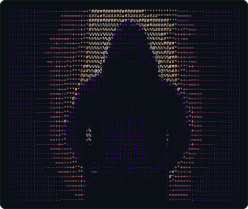
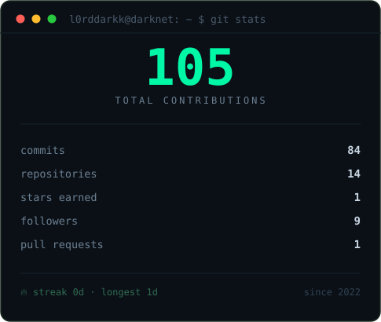

<!-- ╔══════════════════════════════════════════════════════════════╗ -->
<!-- ║                  L0rdDarkk // profile README                   ║ -->
<!-- ║  stats-card.svg + contrib-heatmap.svg auto-refresh daily       ║ -->
<!-- ║  (.github/workflows/update-stats.yml)                          ║ -->
<!-- ╚══════════════════════════════════════════════════════════════╝ -->

<!-- real contribution graph, cells reveal one by one, refreshed daily -->
<h3><code>l0rddarkk@darknet ~ $ ./contributions.sh</code></h3>

 
 

<!-- ascii portrait (left) + live stats card (right); both 485x410 so equal widths give equal heights -->
<h3><code>l0rddarkk@darknet ~ $ whoami</code></h3>

<table>
<tr>
<td valign="top"></td>
<td valign="top"></td>
</tr>
</table>

 
 

<h3><code>l0rddarkk@darknet ~ $ ./links.sh</code></h3>

<b>Cyber Security Engineer · Red Team · HTB Certified Offensive AI Expert</b>

