<!-- ╔══════════════════════════════════════════════════════════════╗ -->
<!-- ║                  L0rdDarkk // profile README                   ║ -->
<!-- ║  Hand-built animated SVG consoles — assets/*.svg               ║ -->
<!-- ║  telemetry.svg auto-refreshes daily via GitHub Actions         ║ -->
<!-- ╚══════════════════════════════════════════════════════════════╝ -->

 

&nbsp;&nbsp;`~/projects`&nbsp;&nbsp;·&nbsp;&nbsp;
[Ads_Blocker_py](https://github.com/L0rdDarkk/Ads_Blocker_py)&nbsp;·&nbsp;
[Arise-Package-Manager](https://github.com/L0rdDarkk/Arise-Package-Manager)&nbsp;·&nbsp;
[Hidden-But-Not-For-You](https://github.com/L0rdDarkk/Hidden-But-Not-For-You-)&nbsp;·&nbsp;
[claude-osint](https://github.com/L0rdDarkk/claude-osint)

&nbsp;&nbsp;`~/contact`&nbsp;&nbsp;·&nbsp;&nbsp;
[LinkedIn](https://www.linkedin.com/in/juled-mardodaj-54b593144/)&nbsp;·&nbsp;
[Portfolio](https://juledmardodaj.vercel.app)&nbsp;·&nbsp;
[Email](mailto:jjtech23@yahoo.com)

 

<code>the quieter you become, the more you are able to hear</code>

